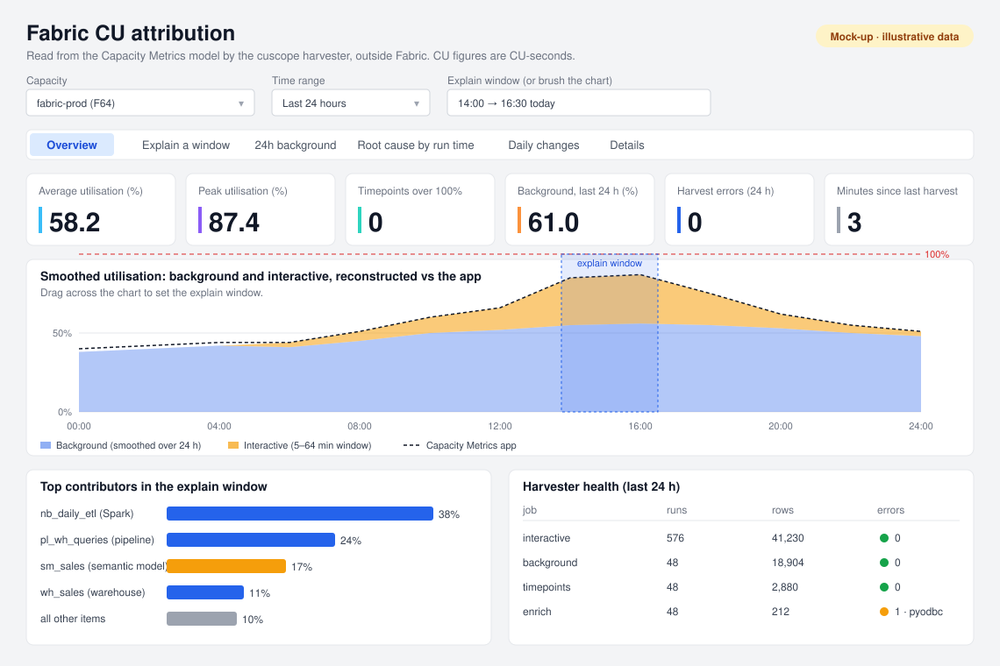

# cuscope: Fabric CU attribution from outside Fabric

[](https://github.com/rameesraja/cuscope/actions/workflows/ci.yml)
[](LICENSE)

**cuscope answers one question: which operation, item or user is using my Microsoft Fabric capacity?**

It reads per-operation CU data from the Microsoft Fabric Capacity Metrics app, stores it in Azure (Log Analytics), and gives you queries and a workbook that explain any spike, throttling event or daily budget. It runs entirely outside Fabric, so it keeps working when your capacity is throttled or paused.

Open source under the [MIT license](LICENSE). Maintained by [Ramees Raja](https://www.linkedin.com/in/rameesraja1992/).



*The Overview tab of the Azure Workbook, redrawn from the deployed workbook with illustrative data (names and IDs anonymised). The workbook is built by [infra/workbook/build_workbook.py](infra/workbook/build_workbook.py) and has six tabs: Overview, Explain a window, 24h background, Root cause by run time, Daily changes and Details. The picture is generated by [docs/make_mockup.py](docs/make_mockup.py).*

## Why you need this

Fabric does not charge an operation at the moment it runs. It **smooths** the cost over time:

- A **background** job (Spark, pipelines, refreshes, warehouse queries) is spread over the next **24 hours**. A notebook that finished at 02:00 is still adding load at 20:00.
- An **interactive** operation (report and DAX queries) is spread over **5 to 64 minutes**.

Throttling is decided on that smoothed series. So when users complain at 16:00, the item that caused it may have run at 02:00, and no chart shows both together.

The Capacity Metrics app has the data, but:

| Limit of the app | What cuscope does |
|---|---|
| Shows one 30-second timepoint at a time | Stores every operation and rebuilds any time range as a query |
| Keeps 14 days | Keeps history in your Log Analytics workspace (90 days by default) |
| Cannot show *when something actually ran* vs *when it was charged* | Reverses the smoothing, so you can see both views |
| Is a Power BI report that runs on a capacity, so it struggles when that capacity is throttled | Runs in Azure Functions with its own storage |
| Does not link a Spark or warehouse charge to the session or query behind it | Matches Spark operations to Livy sessions and splits warehouse CU across SQL queries |
| Has no way to alert on "this item doubled since last week" | Gives you a daily-delta query you can alert on |

Microsoft's own long-retention tools (FUAM, the Chargeback app, Workspace Monitoring) run inside Fabric and consume CU themselves. The reasoning and the mechanics of smoothing are in [research/cu_attribution_research.md](research/cu_attribution_research.md).

## How it works

```
 Capacity Metrics app            Azure Functions (Python)              Azure Monitor
 (semantic model, Pro ws)        timer triggers, managed identity      Log Analytics workspace
 ┌─────────────────────┐  DAX   ┌───────────────────────────┐  DCR   ┌─────────────────────────┐
 │ Timepoint detail,   │ ─────► │ harvest interactive 2.5m  │ ─────► │ Fabric*_CL tables       │
 │ items, capacities   │        │ harvest background  30m   │        │ KQL functions (dedupe,  │
 └─────────────────────┘        │ enrich: Spark, jobs, WH   │        │ un-smoothing, checks)   │
 Fabric REST + Livy + TDS ────► │ checkpoint per capacity   │        │ Azure Workbook          │
 (Spark sessions, queryinsights)└───────────────────────────┘        └─────────────────────────┘
                                   raw JSON also kept in Blob storage
```

1. The harvester calls the Power BI `executeQueries` API on the Capacity Metrics semantic model with the DAX templates in [harvester/dax/](harvester/dax/).
2. Rows are de-duplicated on Operation Id, converted to UTC and written to Blob storage (raw) and Log Analytics (tables).
3. The enrichment job adds Spark sessions, job instances and warehouse query history for the workspaces you list.
4. KQL functions in [kql/](kql/) reconstruct the smoothed series and answer the questions. The workbook is a front end over those functions.

## Repository layout

```
harvester/   Azure Functions app: metrics-model harvester + enrichment (Python, Flex Consumption)
  dax/       DAX templates; the only place metrics-model table and column names live
kql/         Log Analytics functions: dedupe, un-smoothing, validation, per-workload attribution
infra/       Bicep for all Azure resources, deploy script, and the workbook generator
  managed-app/  Roadmap: one-click install (Deploy to Azure button, managed application)
loadgen/     Optional Fabric workload generator for testing (Spark, pipelines, warehouse, semantic model)
research/    Design write-up, tenant runbook, smoke-test script
docs/        Dashboard mock-up
cuscope.config.example.yml   Your deployment settings (copy to cuscope.config.yml)
```

## Prerequisites

- A Microsoft Fabric **F-SKU capacity** (any size) and Fabric admin rights in the tenant.
- An Azure subscription where you can create resources and role assignments. Use the **same region** as the Fabric capacity.
- Entra ID rights to create a security group.
- On your machine: **Python 3.11+**, **Azure CLI** (`winget install Microsoft.AzureCLI` on Windows), and a bash shell (Git Bash on Windows).

## Implementation steps

### Step 1. Create the identity group

In the Entra admin center, create a **security group** named `sg-fabric-monitor` (membership: Assigned). It scopes the Fabric tenant settings in step 2 so you do not open them to the whole organisation. The deployed Function App's managed identity is added to it in step 7.

### Step 2. Allow service principals to use the Fabric APIs

Fabric Admin portal → Tenant settings. Changes can take up to 15 minutes.

| Section | Setting | Value |
|---|---|---|
| Developer settings | Service principals can call Fabric public APIs | On, specific group `sg-fabric-monitor` |
| Integration settings | Semantic Model Execute Queries REST API | On |
| Admin API settings | Service principals can access read-only admin APIs | On, `sg-fabric-monitor` (optional) |
| Audit and usage settings | Azure Log Analytics connections for workspace administrators | On (only for step 9) |

### Step 3. Install the Capacity Metrics app

1. AppSource → **Microsoft Fabric Capacity Metrics** → install it **as a capacity admin**. The app's connection runs as the installer, and that decides what data the harvester can read.
2. Open the app → **Connect**. Set `UTC_offset` to `0` (recommended, so every capacity is on UTC), OAuth2, privacy level Organizational.
3. Open the app's workspace → Workspace settings → License info. Make sure it is **Pro**, not Trial or PPU, so the app does not depend on a capacity you are monitoring.
4. Open the app's semantic model. The URL is `.../groups/<workspace-id>/datasets/<dataset-id>`. **Note both IDs.**
5. Note each capacity's ID (Fabric admin portal → Capacities; the GUID after `/capacities/`) and the app version.
6. Turn off automatic app updates if offered. A new app version can rename model columns (see "Known risks").

### Step 4. Write your configuration

```bash
cp cuscope.config.example.yml cuscope.config.yml
```

Edit `cuscope.config.yml` (git-ignored). The required values are:

| Key | Meaning |
|---|---|
| `resource_group`, `location` | Where Azure resources are created |
| `capacity_ids` | Comma-separated Fabric capacity IDs to harvest |
| `metrics_workspace_id`, `metrics_dataset_id` | From step 3 |
| `metrics_utc_offset` | Must equal the `UTC_offset` you entered in step 3 |
| `enrich_workspace_ids` | Optional. Workspaces whose Spark, jobs and warehouses should be linked to operations |

The file holds IDs only. There are no secrets in it.

### Step 5. (Optional) Test from your laptop first

This costs nothing in Azure and proves the service principal can read the model.

1. In Entra, register an app `cuscope-harvester` (single tenant), create a client secret, and add the app to `sg-fabric-monitor`. Do **not** add Power BI API permissions; tenant settings and workspace roles grant access.
2. Add it as **Member** on the Capacity Metrics app workspace.
3. Copy [research/.env.example](research/.env.example) to `research/.env` and fill it in. To keep the file outside the repo, set `CUSCOPE_ENV_FILE` to its path instead.
4. Run:

```bash
pip install azure-identity requests pyodbc
python research/scripts/sp_smoke_test.py          # rows must come back for a timepoint >= 20 min old
cd harvester && python run_local.py background    # then: interactive, timepoints, dimensions, enrich
```

Output lands in `harvester/local_output/tables/`. A 401 or 403 means a tenant setting from step 2 has not applied yet or the workspace role is missing.

### Step 6. Deploy to Azure

```bash
az login
./infra/deploy.sh
```

The script reads `cuscope.config.yml`, deploys [infra/main.bicep](infra/main.bicep) and zips and publishes the Function code. Arguments override the file: `./infra/deploy.sh rg-cuscope centralindia`. It deploys:

- Log Analytics workspace, the custom `Fabric*_CL` tables and a data collection rule
- Storage accounts for raw JSON and harvester state
- A Flex Consumption Function App with a system-assigned managed identity, plus the role assignments it needs
- The saved KQL functions and the Azure Workbook

When it finishes it prints the Function App name and the **managed identity's object ID**.

### Step 7. Grant the managed identity access in Fabric

Azure cannot grant access inside Fabric for you. Give the managed identity from step 6:

| Where | Grant | Needed for |
|---|---|---|
| Entra group `sg-fabric-monitor` | Member | Tenant settings scoped to that group |
| Capacity Metrics app workspace | Member (or Viewer + Build on the model) | `executeQueries` on the metrics model |
| Each workspace in `enrich_workspace_ids` | Contributor | Livy sessions, job instances, warehouse query history |

The Azure-side roles (storage, DCR) are assigned by the Bicep template.

### Step 8. Check health

Wait about 30 minutes for the first runs, then in Log Analytics → Logs:

```kusto
FabricHarvestHealth()
```

Each row is a job, capacity and table with `runs`, `errors`, `rows` and `last_error`. You want `errors = 0` and recent `last_run` values. A 401 or 403 in `last_error` means a grant from step 7 or a tenant setting from step 2 is missing.

### Step 9. Open the workbook, and optionally add Power BI logs

Azure portal → the resource group → the Workbook `cuscope - Fabric CU attribution`. Choose a capacity and a time range, then drag across the utilisation chart to set the explain window.

For Power BI query text: Fabric workspace settings → Azure connections → Log Analytics → select the `cuscope-law-*` workspace, then save [kql/manual/FabricPbiQueries.kql](kql/manual/FabricPbiQueries.kql) as a function.

### Step 10. Validate for a few days

Run these after 2 to 3 days of data. They compare cuscope with the Capacity Metrics app itself:

```kusto
FabricReconstructionCheck(cap, ago(6h), now())   // diff_pct should be within 1-2 points
FabricCoverage(ago(24h), now())                  // seen_twice_pct should be near 100
```

## Using it

```kusto
let cap = "<capacity guid>";
FabricHarvestHealth()                                                    // is the harvester healthy?
FabricExplainWindow(cap, datetime(2026-10-02 09:00), datetime(2026-10-02 10:00))  // who filled this hour?
FabricBackground24h(cap, now())                                          // what drives the 24 h background %?
FabricRootCauseByHour(cap, ago(24h), now())                              // what ran when
FabricReconstructionCheck(cap, ago(6h), now())                           // does the un-smoothing match the app?
FabricCoverage(ago(24h), now())                                          // are interactive ops seen twice?
FabricDailyDelta(cap)                                                    // items that doubled, new items
FabricSparkAttribution(cap, ago(24h), now())                             // Spark ops ↔ Livy sessions
FabricWarehouseAttribution(cap, ago(24h), now())                         // warehouse CU split across queries
```

## Optional: generate test load

If you have a spare capacity and want data with known causes, [loadgen/](loadgen/) creates a workspace with a Spark notebook, pipelines, a warehouse and a semantic model on a business-day load pattern.

```bash
cd loadgen && python deploy_loadgen.py --workspace-name dev   # writes loadgen/deployed.json (git-ignored)
python interactive_load.py spike --minutes 20                # forces a throttling test
```

Put the resulting IDs in `loadgen_workspace_id` and `loadgen_dataset_id` in `cuscope.config.yml` to enable the interactive timer. Skip this entirely on a production capacity.

## Known risks

- **The Capacity Metrics model is not a public API.** The DAX in [harvester/dax/](harvester/dax/) reads its internal tables. If Microsoft renames them, the harvester breaks until the DAX is updated. Table and column names live only in that folder, so a fix is a config edit. Report breakage as an issue with your app version.
- **Timepoint time zone.** The model reports in the app's `UTC_offset`. A wrong `metrics_utc_offset` shifts all data. The smoke test checks it.
- **ODBC driver on Flex Consumption.** Warehouse enrichment needs `ODBC Driver 18 for SQL Server`. If `enrich` logs a pyodbc error, only warehouse attribution is affected.
- **Cost.** You pay for the Function App, Log Analytics ingestion and storage. The harvester also uses some Fabric CU through its queries (about 1.9% of an F2's daily CU in the author's test); measure it in your tenant.
- **Not affiliated with Microsoft.** This is an independent project.

## Design notes

- Plain timer functions rather than Durable Functions: one invocation per job with a per-capacity checkpoint is simple and resumes after missed runs. Revisit above about 20 capacities.
- No Key Vault. The Function App uses its managed identity, so there are no secrets to store in Azure. The service principal secret for laptop runs stays in your local `.env`.
- Capacity overview events (a real-time throttling alert feed) are not built; they need a second Fabric capacity for the Eventstream.

## Contributing

Issues and pull requests are welcome. Please do not include tenant IDs, workspace IDs, capacity IDs or secrets in issues, logs or sample data. `research/.env`, `cuscope.config.yml`, `harvester/local_output/` and `loadgen/deployed.json` are git-ignored for that reason.

See [CONTRIBUTING.md](CONTRIBUTING.md) for dev setup and pull request guidelines. This project follows a [Code of Conduct](CODE_OF_CONDUCT.md). To report a vulnerability, see [SECURITY.md](SECURITY.md).

## License

[MIT](LICENSE) © 2026 Ramees Raja

## Contact

Questions, ideas or want to collaborate? Reach out on LinkedIn: **[Ramees Raja](https://www.linkedin.com/in/rameesraja1992/)**
